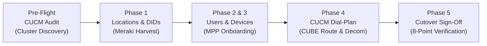

# Webex Calling Migration Pipeline — Operator How-To Guide

This guide provides concise, step-by-step instructions for operating the **5-Phase Webex Calling Migration Pipeline** within NetDashboard. The pipeline automates the complete transition of branch sites, users, and physical endpoints from on-premises Cisco Unified Communications Manager (CUCM) and Cisco Meraki network appliances into Cisco Webex Calling in Control Hub.

---

## 🏗️ The 5-Phase Migration Lifecycle



| Phase | Phase Name | Primary Goal | Key Actions |
| :---: | :--- | :--- | :--- |
| **Pre-Flight** | **CUCM Discovery & Audit** | Identify cluster endpoints and classify hardware tiers | AXL database query, hardware tier breakdown (Tier 1 vs 2 vs 3), inventory CSV export |
| **Phase 1** | **Location Setup & PSTN DIDs** | Establish emergency-compliant calling locations | Meraki MX/Z4 address harvesting, multi-pass parsing, E911 validation, external DID activation |
| **Phase 2 & 3** | **Users & Device Onboarding** | Provision cloud calling profiles & bind MPP phones | Calling license assignment (Professional / Workspaces), user profile activation, cloud phone registration |
| **Phase 4** | **Dial-Plan & Decommissioning**| Eliminate split-brain blackholes & reclaim licenses | Hybrid Route Pattern injection to CUBE/LGW, line disassociation, `SEP<MAC>` deletion in CUCM |
| **Phase 5** | **Post-Cutover Verification** | Audit migration health & confirm sign-off | Automated 8-point checklist: SIP registration, E911 dispatch, dial-plan parity, license audit |

---

## 🔑 Prerequisites & Authentication

1. **Required RBAC Role:** You must be signed in with the **`NetworkAdmin`** role.
2. **Webex Bearer Token:**
   * Personal access tokens expire after **12 hours**.
   * Verify the **Webex Token** badge in the header shows **`Active (12h)`**. If it displays **`Not Set`**, click **Set (12h)**, paste your token, and save.
   * Tokens are held in browser session memory and passed securely via `X-Webex-Access-Token`.
3. **Step-Up Authentication:** High-impact operations (live Webex provisioning and CUCM decommissioning) prompt for administrative Active Directory credentials at execution.

---

## 🔍 Pre-Flight: CUCM Discovery & Hardware Audit

Assess on-premises phone compatibility and line inventory before touching cloud configurations.

1. Navigate to **Telecom Migration** &rarr; **Migration Pipeline (All)**.
2. Select the target **CUCM Cluster**:
   * **`PRIMARY`** — Mainland Production (CUCM 12.5)
   * **`HAWAII`** — Hawaii Regional Production (CUCM 11.5)
3. Select your **Target Endpoint Scope**:
   * `Physical Phones (SEP*)` — Hardware IP phones (recommended)
   * `All Endpoints` — Physical phones and softphones
   * `Softphones (CSF / TCT / BOT)` — Desktop and mobile clients
   * `Analog / ATAs (VG / ATA)` — Analog gateways
4. (Optional) Filter by **Device Pool** (e.g. `DP_Hawaii`).
5. Click **Run Audit**. Review the hardware tier cards:
   * **Tier 1 (MPP Direct):** Cisco 88xx / 78xx / 98xx models eligible for direct cloud or enterprise-to-MPP conversion.
   * **Tier 2 (Gateway / ATA):** Analog endpoints requiring Local Gateway (CUBE) or ATA migration.
   * **Tier 3 (Incompatible):** Legacy endpoints (7940/7960, 69xx) requiring hardware refresh.
6. Click **Export CSV Package** to retain the raw audit data.

---

## 📍 Phase 1: Location Setup & PSTN DIDs (Meraki-Powered)

Webex Calling requires physical calling locations for emergency E911 dispatch before users or phones can exist.

### 1. Harvest & Normalize Meraki Locations
1. Click **Fetch Meraki Locations**.
2. NetDashboard correlates MX/Z4 appliance metadata and processes addresses through the **multi-pass address engine**:
   * Extracts unit identifiers (`Suite 200`, `Ste 4`, `#101`) into Address Line 1.
   * Identifies street vs. city boundaries when commas are absent in Meraki.
   * Standardizes 2-letter state codes and 5/9-digit ZIP codes.
3. Review KPI cards:
   * **Total Meraki Sites:** Total unique MX/Z4 networks.
   * **Exists in Webex:** Sites already provisioned in Control Hub.
   * **Ready to Provision:** Sites with complete addresses ready for creation.
   * **Address Incomplete:** Sites with missing fields flagged for Meraki review.

### 2. Configure Telephony & Sync
1. Set site telephony parameters:
   * **Calling Connection:** `Local Gateway (Premises PSTN / CUBE)` or `Cisco PSTN`.
   * **Extension Length:** `4 Digits`, `5 Digits`, or `6 Digits`.
   * **Routing Prefix / Steering Code:** Optional inter-site routing prefix (e.g., `8`).
2. Select target sites using the checkboxes.
3. Click **Dry-Run Location Sync** to verify payload integrity without committing.
4. Click **Sync to Webex Calling** to provision the locations in Control Hub.

### 3. Add & Activate External PSTN DIDs
1. In the **Add & Activate External PSTN DIDs** panel, select the target **Webex Location**.
2. (Optional) Enter a **Main Pilot DID** in E.164 format (e.g., `+15125550100`).
3. Enter DIDs in the text area (one per line, E.164 format: `+1XXXXXXXXXX`).
4. Click **Dry Run DIDs** &rarr; verify formatting &rarr; click **Activate DIDs**.

---

## 👥 Phase 2 & 3: Users & MPP Device Onboarding

Automate user calling license assignment, extension configuration, and physical IP phone cloud registration.

### 1. Stage User & Device Batch
1. Click **Stage Batch CSV** or download the **Calling Users Template (.csv)**.
2. Required CSV fields:
   * `email` — Corporate user email (Entra ID / Okta identity).
   * `extension` — Internal calling extension (e.g., `4123`).
   * `phoneNumber` — (Optional) Direct external DID (`+15125554123`).
   * `locationName` — Target Webex location created in Phase 1.
   * `mac` — 12-digit hexadecimal phone MAC (`001122334455`), or leave blank for **softphone-only** Webex App users.
   * `model` — Cisco MPP phone model (`Cisco 8841`, `Cisco 8851`, `Cisco 7841`, `Cisco 9841`), or `Webex App (Softphone)` / blank for softphone-only users.
3. Click **Validate Batch** to run pre-flight checks (MAC sanitization, duplicate extension check, location parity).

### 2. Provision Calling Users
1. Select the appropriate **Calling License** from the dropdown:
   * `Webex Calling - Professional` — Full-featured named user profile (automatically replaces any conflicting Unified CM Calling license when migrating CUCM-registered Webex App users to Webex Cloud).
   * `Webex Calling - Workspaces` — Shared / common area phone profile.
2. Click **Dry-Run User Provisioning** to verify quota and tenant readiness.
3. Click **Provision Calling Users** to assign licenses, configure extensions, and link external numbers.
   > **Role Safety:** NetDashboard preserves existing user administrative privileges (`roles`, `siteAdmin`, `orgId`) to prevent privilege stripping during updates.

### 3. Onboard MPP Devices or Provision Softphone-Only Users
1. In **Phase 2 & 3: Users & Devices** (**User Calling Profile & Device Onboarding Console**):
   * **Physical IP Phones (Option A / Option B):** Review staged devices, run **Dry Run**, and click **Execute Onboarding** to register MACs and generate 16-digit activation codes.
   * **Softphone-Only Users (Option C: Softphone-Only User):** Select the **Option C** card to hide MAC/model fields, pick the target **Webex Location** and **Webex Calling License**, and either provision a single user (**Provision Softphone User**) or paste/upload a list in the **Batch Softphone-Only User Provisioning** box (**Provision Softphone Batch**). Webex App registers automatically to Webex Cloud once licensed.
   * Alternatively, in **Migration Pipeline (All)**, select **Target Endpoint Scope: Softphones (CSF / TCT / BOT)**, click **Run Audit**, and click **Ingest Selected to Webex**.

---

## ✂️ Phase 4: CUCM Dial-Plan & Decommissioning

Prevent split-brain routing blackholes during coexistence and decommission on-premises phones to reclaim Cisco Smart Licenses.

```text
CUCM Phone Dials Ext 4199 
    └──> Hits Route Pattern 4199 in CUCM Route Partition
            └──> Forwards to Local Gateway (CUBE/LGW SIP Trunk)
                    └──> Webex Calling Cloud rings newly migrated user!
```

### 1. Device Decommission & Smart License Release
1. Enter the physical phone MAC (`SEP<MAC>` / `001122334455`), CUCM softphone device name (`CSF*`, `TCT*`, `BOT*`, `TAB*`, or named devices like `ThomasJabber`), or comma-separated device list. You can also enter the user's **Extension** and click **Find Devices by Ext** to auto-populate all CUCM devices sharing that Directory Number (e.g., both `BOTSTTM` and `ThomasJabber`).
2. Check **Delete Directory Number from numplan once all devices are removed** to free the extension/partition (CUCM cannot insert a Route Pattern while the DN still exists in the same partition).
3. Check **Also create Route Pattern for hybrid routing** (using the Step 2 Partition & Gateway/Route List) so NetDashboard deletes the device(s), removes the unassigned DN, and creates the Route Pattern in the right order.
4. Execute with **Dry Run** first, then uncheck and click **Decommission Device(s)** to delete from CUCM and release Smart Licenses.

### 2. Hybrid Route Pattern Injection
1. Select the target **Cluster** (`PRIMARY` or `HAWAII`), **Route Partition** (e.g., `Global-PT-Internal`), and **Gateway / Route List** pointing to CUBE (e.g., `WebexCUBE_RL`).
2. If you already removed the old device(s) & DN in Step 1 without auto-creating the pattern, enter the migrated **Extension / DN** (e.g., `801682`) and click **Inject Route Pattern** (defaults to Dry Run, uncheck for live injection).

---

## ✅ Phase 5: Post-Cutover Verification & Licensing Audit

Immediately following site cutover, execute the automated 8-point verification suite.

1. Select the migrated location and click **Run Verification Suite**.
2. The verification engine audits:
   * **1. Location E911 Compliance:** Validates street address, state code, and ZIP recognized by RedSky.
   * **2. Emergency Callback Number (ECBN):** Confirms valid caller ID assignment for 911 dispatch.
   * **3. Dial-Plan Parity:** Verifies extension length and steering code configurations.
   * **4. User Calling State:** Validates user calling entitlement (`ACTIVE`).
   * **5. Device SIP Registration:** Audits phone registration with the Webex cloud proxy (`registered` vs `offline`).
   * **6. Line Appearance Health:** Confirms primary line key assignment on MPP phones.
   * **7. Firmware Level:** Flags outdated MPP firmware versions.
   * **8. License Reconciliation:** Compares consumed Calling licenses against tenant quotas.
3. Click **Download Verification PDF/CSV** to archive the compliance artifact for your change control record.

---

## 🛠️ Quick Troubleshooting Guide

| Issue | Root Cause | Solution |
| :--- | :--- | :--- |
| **`401 Unauthorized` / Webex API Error** | 12-hour Webex personal access token expired | Generate fresh token at [developer.webex.com](https://developer.webex.com), click **Set (12h)**, and paste token. |
| **`Address Incomplete` in Phase 1** | Meraki appliance missing street, city, or ZIP | Update address in Meraki Dashboard under *Appliance Status*, then click *Fetch Meraki Locations*. |
| **User Admin Rights Lost** | Previous tool stripped `roles` payload | Fixed in NetDashboard engine. In Control Hub, have an existing Full Admin re-assign your role. |
| **Internal Calls Drop to Migrated User** | CUCM still thinks extension is on-premises | Execute Phase 4 Step 1: Inject Route Pattern pointing extension to Local Gateway (CUBE). |
| **MAC Address Already Registered** | Device claimed in another Webex organization | In Webex Control Hub, delete phone from the previous organization or open a Cisco TAC case to release MAC. |
