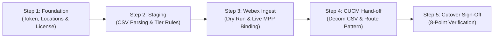

# Webex Calling Workspace & MPP CSV Studio — Operator How-To Guide

This guide explains how to operate NetDashboard's **Webex Calling Bulk CSV Migration & Onboarding Studio** (`telecom_workspaces.html`). Built specifically for vendor migration spreadsheets, the studio organizes bulk onboarding into a clear **5-step phased deployment pipeline**, from prerequisite discovery to post-import CUCM dial-plan hand-off.

---

## 🏗️ Phased Bulk CSV Deployment Architecture



| Step | Studio Step | Migration Phase Equivalent | Key Purpose |
| :---: | :--- | :---: | :--- |
| **Step 1** | **Foundation: Location & License** | **Phase 1** | Verify Webex token, ensure Control Hub calling locations exist, and select Calling License. |
| **Step 2** | **CSV Staging & Rules Engine** | **Phase 2 & 3** | Upload/paste CSV, auto-clean MACs, classify hardware tiers, and map target locations. |
| **Step 3** | **Physical MPP Device Ingest** | **Phase 3** | Execute pre-flight dry run simulation, then live provision workspaces and bind MPP phones. |
| **Step 4** | **CUCM Coexistence Hand-off** | **Phase 4** | Export CUCM decommission batch CSV and inject hybrid Route Patterns to CUBE/LGW. |
| **Step 5** | **Cutover Verification** | **Phase 5** | Transition to the automated 8-point checklist to audit SIP registration, E911, and licenses. |
| **Day-2** | **Maintenance & Recovery** | **Post-Cutover** | Correct misplaced workspace locations in-place and recover detached physical phones. |

---

## 🔑 Before You Begin

1. **Role Requirement:** You must be signed in as a **`NetworkAdmin`**.
2. **Webex Bearer Token:**
   * Enter your 12-hour Webex personal access token into the **Webex Bearer Token** input in Step 1, or click **Set Token**.
   * Click the **Refresh** button (`⟳`) to query Webex Control Hub. The connection status updates to:
     `Connected. Loaded X locations and Y licenses.`
3. **Safety Notice:** Live imports modify production Webex Control Hub. **Always run a Pre-Flight Dry Run** before executing live provisioning.

---

## 📋 Step 1: Foundation (Prerequisites, Locations & License)

Webex Calling requires calling locations to exist in Control Hub before workspaces or phones can be created.

### 1. Webex Token & Connection
* Verify your token is entered and active. The token status badge confirms connectivity.

### 2. Location Parity Check
* Inspect **Webex Calling Locations**. The card displays the count of discovered locations.
* If a target branch site is missing, click **Go to Phase 1 Location Sync &rarr;** to harvest and provision the site from Meraki appliances before proceeding.

### 3. Calling License Selection
* Select the intended tenant license from the **Calling License** dropdown:
  * **`Webex Calling - Workspaces`** — Designed for common area, conference room, and shared workstation phones.
  * **`Webex Calling - Professional`** — Full-featured named user profile.
* *Note:* The selected license automatically synchronizes across all NetDashboard migration tools.

### 4. Download Standardized CSV Templates
* Quick-download pre-formatted template spreadsheets:
  * `Workspaces Template (.csv)` — For creating new calling workspaces with phones.
  * `Calling Users Template (.csv)` — For migrating named users with phone assignments.
  * `Locations Template (.csv)` — For site location preparation.
  * `Preview MX / Z4 Locations` — Generates location CSVs directly from Meraki network appliances.

---

## 📥 Step 2: CSV Data Staging & Validation Engine

### Supported Input Formats

#### Format A: New Calling Workspaces with MPP Phones
```csv
displayName,locatioName,type,capacity,callingType,extension,mac,model
CLH Lanihuli Lounge Phone,CLH - Billing Lanihuli,desk,1,webexCalling,851845,70BD96EC9906,Cisco 9841
CLH Lanihuli Breakroom,CLH - Billing Lanihuli,desk,1,webexCalling,851846,70BD96EC9907,Cisco 8841
```
* **Vendor Column Tolerance:** Tolerates vendor headers such as `locatioName` (missing 'n'), `Workspace Name`, `MAC Address`, and `Device Model`.
* **Defaults:** Automatically defaults missing `type` to `desk`, `capacity` to `1`, and `callingType` to `webexCalling`.

#### Format B: Assign Phones to Existing Users or Workspaces
```csv
macAddress,model,ownerType,ownerEmail,personId,workspaceId,locationName,displayName
70BD96EC9906,Cisco 8841,USER,alex@example.com,,,CLH - Billing Lanihuli,Alex Example
70BD96EC9907,Cisco 8841,WORKSPACE,,,ws-uuid-1234,CLH - Billing Lanihuli,Conference Room
```
* Use `ownerType=USER` (with `ownerEmail` or `personId`) to bind phones to existing employees.
* Use `ownerType=WORKSPACE` (with `workspaceId` or `displayName`) to add phones to existing workspaces.

### Ingestion Methods
* **Drag-and-Drop:** Drag your `.csv` file onto the upload box. Validation begins automatically.
* **Paste Raw CSV:** Paste CSV text into **Or Paste Raw CSV Data** and click **Parse & Validate Staging Data**.
* **Quick Presets:** Use **Load CLH Dataset (222 Rows)** or **Load Vendor Workspace CSV (177 Rows)** to load test batches.

### Validation Rules Applied Automatically
* **MAC Normalization:** Strips colons (`:`), dashes (`-`), and spaces, validating exactly 12 hexadecimal characters.
* **Hardware Tier Classification:**
  * 🟢 **Tier 1 MPP Direct:** Cisco 78xx, 88xx, 98xx models eligible for cloud provisioning.
  * 🟡 **Legacy Refresh:** Cisco 79xx, 69xx models flagged requiring hardware replacement.
* **Location Mapping:** Case-insensitive matching against discovered Control Hub calling locations.
* **Extension Uniqueness:** Verifies extension digits and checks for duplicates within the target location.

### Metrics KPI Dashboard
* **Total Rows:** Total records parsed from the CSV.
* **Ready for Webex:** Fully validated rows with valid MACs, extensions, and mapped locations.
* **Warnings (Legacy):** Valid rows with legacy hardware models flagged for review.
* **Errors (Blocked):** Rows missing locations, invalid MACs, or duplicate extensions.
* **Locations Mapped:** Count of distinct Control Hub locations resolved.

---

## 🚀 Step 3: Physical MPP Device Binding & Provisioning Console

### 1. Filter & Inspect Staged Rows
* Use the filter tabs: **`All Rows`**, **`Ready`**, **`Warnings`**, **`Errors`** to review validation notes.
* Toggle individual row checkboxes or use the master checkbox to select the target batch.

### 2. Export Cleaned Data (Optional)
* **`Export Cleaned CSV`:** Downloads the selected rows with normalized 12-character MACs.
* **`Export Postman Collection`:** Generates a Postman v2.1 collection for offline API execution.

### 3. Pre-Flight Dry Run Simulation
* Click **Pre-Flight Dry Run**.
* Simulates Webex API requests against Control Hub to verify payload structure and authorization without creating objects or consuming licenses.
* Review dry-run results in the **Webex Calling Provisioning Progress** log.

### 4. Live Ingestion to Webex Calling
1. Click **Ingest to Webex Calling**.
2. Confirm the safety prompt. NetDashboard requests administrative step-up credentials.
3. The execution engine processes rows sequentially:
   * **Workspace Creation:** Creates the calling workspace with the assigned extension and calling license.
   * **Device Association:** Registers the physical MPP phone MAC and binds it to the newly created workspace (or existing user).
4. Monitor the live telemetry progress bar and log stream (`[Row X] Display Name (MAC) -> SUCCESS [WorkspaceID: ...]`).

---

## ✂️ Step 4 & 5: Post-Import Transition & Cutover Hand-Off

Once devices are live in Webex Calling, complete the migration lifecycle:

### Step 4: CUCM Coexistence Hand-off
* **Why this is required:** To prevent internal dropped calls during coexistence, CUCM Translation Patterns must route migrated extensions to the Local Gateway (CUBE/LGW). Physical `SEP<MAC>` devices must then be removed from CUCM 12.5 to release Cisco Smart Licenses (UCL/CUWL).
* **Actions Available:**
  * **`Export CUCM Decommission Batch (CSV)`:** One-click generation of a pre-formatted CSV containing:
    `Device Name (SEP<MAC>), Directory Number (Ext), Description, Location, Model, PENDING_CUCM_DECOMMISSION`
  * **`Open Phase 4 CUCM Dial-Plan Console &rarr;`:** Switches directly to Phase 4 to inject hybrid Route Patterns into CUBE/LGW and decommission physical phones.

### Step 5: Post-Cutover Verification
* **Why this is required:** Confirms newly provisioned extensions and MPP phones are operational and compliant.
* **Action Available:**
  * **`Open Phase 5 Verification Console &rarr;`:** Switches directly to Phase 5 to execute the automated 8-point audit (SIP registration, E911 dispatch, dial-plan parity, and license reconciliation).

---

## 🔧 Day-2 Operations: Location Correction & Phone Recovery

Located at the bottom of the tool, this utility addresses Day-2 operational issues for existing imports:

### Workflow 1: Correct Misplaced Workspace Locations
* **Non-calling workspaces:** Moved in-place to the corrected location.
* **Calling-enabled workspaces:** Because Webex restricts moving calling-enabled workspaces across locations directly, NetDashboard creates an equivalent replacement workspace at the target location, verifies calling and MPP device attachment, and only then deletes the original workspace.
* **Usage:** Provide corrected CSV &rarr; click **Preview Location Migration** &rarr; review results &rarr; click **Apply Location Migration**.

### Workflow 2: Restore Detached Phones
* Restores unassigned or detached phones to their original workspaces without altering location configurations.
* **Usage:** Click **Preview Device Recovery** &rarr; review unassigned devices &rarr; click **Restore Detached Phones**.

---

## 🛠️ Quick Troubleshooting Guide

| Issue | Cause | Resolution |
| :--- | :--- | :--- |
| **No licenses appear in Calling License dropdown** | Token expired or tenant lacks workspace licenses | Click `⟳` refresh. Verify your Webex token has administrative scopes. |
| **Row marked with `Unmapped Location`** | CSV location name differs from Control Hub | Check spelling in CSV, or click *Go to Phase 1 Location Sync* if the location has not been created yet. |
| **Row marked with `ERROR: Bad MAC`** | MAC has incorrect length or non-hex characters | Ensure MAC address contains exactly 12 hexadecimal characters (colons and hyphens are stripped automatically). |
| **Row marked with `WARNING: Legacy Refresh`** | Phone model is Cisco 79xx or 69xx | Model is flagged for hardware refresh. Does not block import if intended, but requires replacement for direct cloud MPP support. |
| **Live row fails during device association** | Workspace created, but MAC is claimed elsewhere | Inspect Control Hub. Delete stale device registration in Webex, then re-associate MAC to the generated Workspace ID. |
